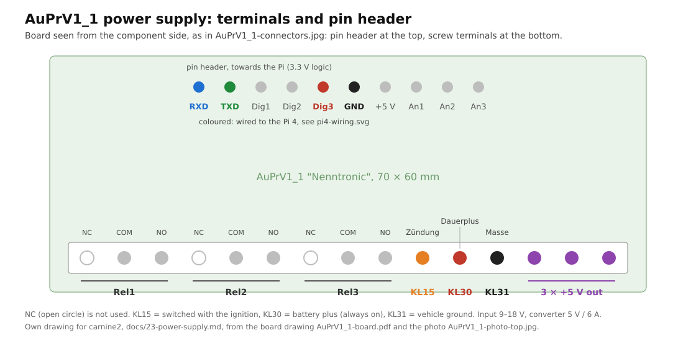
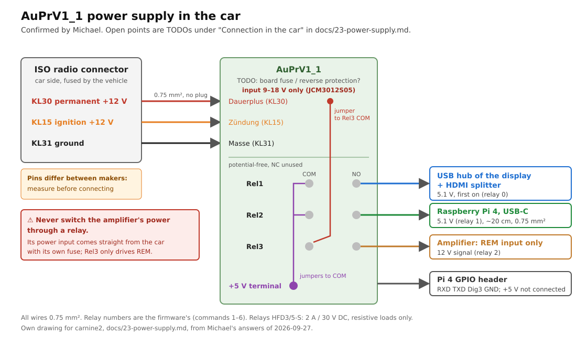
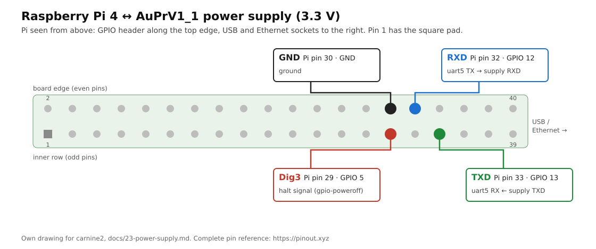

# 23 – Vehicle Power Supply (Ignition, Shutdown, Watchdog)

**Status:** partly integrated (v0.9.3). The backend sends the sign of life and
reports the supply's state since v0.6.0, shuts the Pi down on POWEROFF
since e1aa949 and switches the amplifier on Rel3 since 9730edf; `$` and the
service mode are still open (#36, see
[What carnine2 needs for it](#what-carnine2-needs-for-it)).
The hardware and its firmware
come from the predecessor project
[DerKleinePunk/carnine](https://github.com/DerKleinePunk/carnine); the
firmware is now in [firmware/powersupply/](../firmware/powersupply/README.md)
and builds here. The test board runs it and talks to the test Pi over
uart5.

## Why

In the car the Pi must not lose power while it writes to the SD card, and it
must not drain the battery when the car is parked. The power supply watches
the ignition (terminal 15, KL15), switches the Pi and the peripherals on and
off, gives the Pi time to shut down, and power-cycles a Pi that hangs.

## Board

**AuPrV1_1 "Nenntronic"**, 70 × 60 mm, from 2023-02: ATmega88P, three
relays, IR receiver, DC/DC converter XP Power JCM3012S05. Two of these exist.
Drawings: [board](hardware/power-supply/AuPrV1_1-board.pdf),
[layout](hardware/power-supply/AuPrV1_1-layout.jpg),
[connectors](hardware/power-supply/AuPrV1_1-connectors.jpg) (old names
`MichaelNenninger_Power_a3.pdf`, `RaspberryNetzteil*.jpg`). The old project
also has a UPS board and a "MicroPower" board; both were experiments that did
not work out and are not used.


The photo (2026-09-27, turned by 180°) shows the installed board with the
converter and the three relays; the labels on both can be read:

- **Converter:** XP Power **JCM3012S05**, printed "Input: 9-18 VDC,
  Output: 5 VDC 6.00A". The
  [JCM30 datasheet](https://www.xppower.com/portals/0/pdfs/SF_JCM30.pdf)
  gives for it 9–18 V in (12 V nominal), 5.0 V / 6.0 A out (30 W), 89 %
  efficiency, 2810 mA input current at full load and nominal input, and an
  input surge of 25 V for 100 ms. The old project's figures, input 9–30 V
  and output 5.15 V / 4 A, do not match the converter. The board raises
  the converter's 5.0 V to **5.1 V** with a resistor on the converter's
  trim input ([Raising the output to 5.1 V](#raising-the-output-to-51-v));
  Michael measured 5.1 V at the output of the supplies.
- **Relays (3×):** Hongfa **HFD3/5-S**, printed "2A 30VDC, 0.5A 125VAC".
  According to the
  [HFD3 datasheet](http://www.hongfaamerica.com/hq/PDF/HFD3_en.pdf) that is
  a 5 V coil, single side stable, SMT, with two changeover contacts (2C),
  rated 2 A at 30 V DC and 0.5 A at 125 V AC for a resistive load. The
  board's developer confirms 30 V / 2 A.

> **Warning: 18 V is the input limit.** The converter is made for a 12 V
> system: 9–18 V, briefly 25 V for 100 ms. A car's voltage often rises
> above 14 V while the battery charges, which is within that range, but the
> board is **not suitable for a 24 V system**. Nothing is known about an
> overvoltage protection on the board.

### Raising the output to 5.1 V

The JCM30 converters have a trim input that moves the output by up to
±10 %. A resistor between **Trim (pin 5)** and **−Vout (pin 6)** raises the
output ("trim up" in the
[JCM30 datasheet](https://www.xppower.com/portals/0/pdfs/SF_JCM30.pdf),
"External output trimming"). The pins of the converter, as the datasheet
numbers them: 1 +Vin, 2 −Vin, 3 Remote On/Off, 4 +Vout, 5 Trim, 6 −Vout.

Both AuPrV1_1 boards carry such a resistor, soldered on afterwards on the
back of the board, behind the converter (Michael, 2026-10-04):


The resistor on the boards is **120 kΩ** (colour bands brown, red, yellow;
Michael, 2026-10-04). In the datasheet's table of trim-up resistors for the
5 V model, 120 kΩ lies between +3 % (133.3 kΩ) and +4 % (93.4 kΩ), about
+3.3 % or 5.17 V nominal. The converter's initial set accuracy is ±1 %;
Michael measured **5.09 V** at the output (2026-10-04), which fits. (The table gives the same
618 kΩ for +1 % and +2 %, so its lowest steps are not to be relied on.)

### AuPrV1_1 connections


- **Screw terminals (bottom):** Rel1, Rel2, Rel3 (three contacts each),
  Zündung (KL15), Dauerplus (KL30), Masse, 3 × +5 V out.
- **Pin header (top), towards the Pi:** RXD, TXD, Dig1, Dig2, Dig3, GND,
  +5 V, Analog1–3.
- **Relays:** Rel1 = relay 0 in the firmware (display: USB hub and HDMI splitter),
  Rel2 = relay 1 (Pi power), Rel3 = relay 2 (amplifier), confirmed by
  Michael. The order matters: the displays must be on before the Pi boots.
- **USB socket and jumper (top right):** the board has its own USB-serial
  converter. A jumper connects the microcontroller's serial line either to
  the USB socket (jumper towards the socket: programming) or to the pin
  header (other side: running on the Pi). In the wrong position the Pi
  receives the supply's output but its commands never arrive. The alive
  signal `+` does not arrive either, so the supply goes round in a circle
  about every 71 s: `RUN`, "alive counter low", `POWEROFF`, `POWERON`,
  `PIBOOT`, `RUN` again (carnine-pc, 2026-10-06, jumper left on programming).
  A Pi fed through Rel2 is switched off every time.
  In the planned enclosure Michael's IO board sits stacked on top of this
  board (same size, the holes line up), which covers the jumper and the USB
  socket: flashing means taking the stack apart. Accepted, since the
  firmware is flashed rarely (Michael, 2026-10-06).
- **Pi power:** the Pi is fed from the supply through its USB-C socket,
  not through the 5 V pins of its GPIO header. Raspberry Pi asks for a
  5.1 V supply, and the Pi logs an undervoltage below 4.63 V (±5 %). The
  converter is rated 5.0 V; the board raises it to 5.1 V so that this
  undervoltage does not occur (Michael measured 5.1 V at the output).
  Not measured yet: the voltage under load, and `vcgencmd get_throttled`
  with the Pi running on the supply. Raspberry Pi names USB-C as the Pi 4's
  power input and recommends a USB-C supply for it
  ([documentation, "Power supply"](https://www.raspberrypi.com/documentation/computers/raspberry-pi.html));
  the same page warns under "Back-powering" that power fed in elsewhere
  bypasses the Pi's protection circuitry. The
  [HAT design guide](https://github.com/raspberrypi/hats/blob/master/designguide.md),
  section "Back Powering the Pi via the GPIO Header", allows 5 V ±5 % on
  header pins 2 and 4. On the A+, B+, 2B and 3B those pins sit behind the
  input's polyfuse and reverse-current diode, so feeding them bypasses
  both; the 3B+ and 4B have no such input diode at all. Whoever feeds the header is responsible for that
  protection (a diode or an equivalent guarantee that both supplies can be
  connected at once, and a 5 V / 2.5 A source). carnine2 avoids this by
  feeding only USB-C. Michael's earlier car PCs were wired the same way. The +5 V pin of the supply's header is therefore not
  connected to the Pi, on purpose; the Pi gets its power only through
  USB-C.

The serial lines run at **3.3 V**, so they connect to the Pi directly,
without a level shifter.

### Terminals and pin header



Screw terminals, from left to right with the board seen from the component
side (pin header at the top):

| Position | Label | Use |
|---|---|---|
| 1–3 | Rel1 | relay 0: USB hub of the display and HDMI splitter, 5 V; NC, COM, NO |
| 4–6 | Rel2 | relay 1: Pi power; NC, COM, NO |
| 7–9 | Rel3 | relay 2: amplifier's remote input (REM), 12 V; NC, COM, NO |
| 10 | Zündung | **KL15**, plus switched by the ignition; the firmware reads it |
| 11 | Dauerplus | **KL30**, battery plus, always on; feeds the supply |
| 12 | Masse | **KL31**, vehicle ground |
| 13–15 | +5 V | converter output, 5.1 V (measured), up to 6 A in total |

The +5 V terminals sit before the relays. Besides Rel1 and Rel2 they feed
Michael's IO board, whose fan output JP10 carries the two case fans, about
0.36 A together (2 × 0.9 W at 5 V from the ebm-papst 405 FH datasheet, not
measured; see [07 – Deployment](07-deployment.md)). That current flows
through the converter only, not through Rel2.

Pin header, from left to right: RXD, TXD, Dig1, Dig2, Dig3, GND, +5 V,
Analog1, Analog2, Analog3. RXD, TXD, Dig3 and GND go to the Pi (see
[Wiring to the Pi 4](#wiring-to-the-pi-4)); Dig3 carries the Pi's halt
signal for the kernel shutdown. Dig1, Dig2 and Analog1–3 are free and have
no function yet. The board drawing
([AuPrV1_1-board.pdf](hardware/power-supply/AuPrV1_1-board.pdf)) shows two
more pads after Analog3, labelled 3.3 V and "unbenutzt" (unused), which
the connector drawing leaves out.

The KL15, KL30 and KL31 names are the usual German terminal numbers
(DIN 72552).

### Connection in the car



carnine2 is an open-source project and is not described for a particular
vehicle. The supply connects to the car radio's ISO connector; its pin
assignment depends on the vehicle and is checked with a meter before
connecting. As Michael described it on 2026-09-27:

- **KL30, KL15 and ground come from the ISO connector,** with the wires
  going straight into the screw terminals, without another plug.
- **Measure before connecting.** Which ISO pins carry permanent and
  switched plus differs between makers. With the ignition off only KL30
  must carry 12 V; with the ignition on both do.
- **Fuses** are not part of this setup: the radio connector is taken to be
  fused by the vehicle.
- **Mounting:** the board sits right next to the Pi, so the line to the Pi
  stays short: about 20 cm.
- **Wires:** all of them are 0.75 mm², KL30, KL15, ground, the relay
  outputs and the line to the Pi. At most the converter's full load flows
  in: 2810 mA at 12 V according to its datasheet; at the lower limit of
  9 V that would be about 3.7 A (30 W / 89 % / 9 V, an estimate, not
  measured). The amplifier's remote line carries only a control current.
- **Relays are potential-free contacts.** The board does not put any
  voltage on them; which voltage a relay switches is set by the wiring, so
  the board can serve other uses as well. Each relay has three terminals,
  from left to right NC, COM and NO (terminal strip at the bottom); NO
  closes when the relay is on. On all three, COM and NO are used and NC is
  free.
  - **Rel1:** a wire jumper from a +5 V terminal to COM; NO feeds the
    display's USB hub and the HDMI splitter.
  - **Rel2:** wired the same way, +5 V jumpered to COM, NO to the USB-C
    cable of the Pi.
  - **Rel3:** a wire jumper from the Dauerplus terminal (KL30) to COM; NO
    goes to the amplifier's remote input (REM), the control pin that turns
    it on and off.

> **Warning:** Rel3 switches only the amplifier's remote input. A car
> amplifier takes its power through a separate heavy cable straight from
> the vehicle, with its own fuse. Never switch that power through one of
> the board's relays: it cannot carry the current and burns.

> **Warning: resistive loads only, up to 2 A.** The relays are rated 2 A at
> 30 V DC and, according to the board's developer, are not meant for
> inductive loads such as motors, coils, solenoid valves or other relays.

**Open, not measured:** Rel2 carries the whole current of the Pi 4 through
USB-C, Rel1 that of the display's USB hub and the HDMI splitter. The Pi 4's
recommended supply delivers 3 A. On the test units Rel2 also feeds the CPU fan
on header pins 4 and 6, which draws from the Pi's 5 V. Whether the current through each relay
stays below 2 A has not been measured. Whether the board connects the
relay's two contact sets in parallel is not known either. In the layout
drawing only one set per relay (pads A1, S1, B1) has visible tracks to the
terminals; the other set (A2, S2, B2) shows none, but those pads lie in a
copper pour in the connector drawing, and both drawings still contain
unrouted airwires, so the drawings do not settle it.

**TODO** (Michael is asking; not documented until answered):

- whether the board has its own fuse or reverse-polarity protection.

### Wiring to the Pi 4

The supply gets its own UART, **uart5**, so Bluetooth keeps the Pi's default
UART; uart4 is not used because GPIO 8/9 belong to SPI0, which a CAN adapter
(MCP2515, see [24 – CAN Adapter](24-can-adapter-mcp2515.md)) needs.



| Supply | Pi 4 | Header pin |
|---|---|---|
| RXD | GPIO 12, uart5 TXD | 32 |
| TXD | GPIO 13, uart5 RXD | 33 |
| Dig3 | GPIO 5, `gpio-poweroff` | 29 |
| GND | GND | 30 (34 works too; 6 is taken by the CPU fan) |

RXD and TXD on the supply are taken as its own receive and transmit line,
so they cross over to the Pi's TX and RX (checked on the device). If
`/dev/powersupply` shows nothing, swap the two wires with the Pi switched
off; if it shows output but `v` gets no answer, check the jumper. The old project wired RXD/TXD to the default UART (GPIO 14/15); with
uart5 the cable goes to pins 32/33 instead. The full header is on
[pinout.xyz](https://pinout.xyz). The backend package's udev rule
(`61-carnine-powersupply.rules`) names the line `/dev/powersupply`, whatever
ttyAMA number it gets.

**Image:** `uart5` is always enabled (it is unused without a supply). The
halt signal only with `-t power_supply:auprv1` when building the image,
because the overlay's README requires a supply that really cuts power when
signalled; without one, powering off ends in a kernel BUG and the Pi keeps
drawing current. Without the parameter the line is in `config.txt` commented
out. `active_low` also pulls GPIO 5 low on a reboot and early in the boot;
the firmware only looks at Dig3 in POWEROFF, so that does no harm.

## Firmware (V2.4.1)

[firmware/powersupply/](../firmware/powersupply/README.md), taken over from
the old project (V2.2.12); V2.3.0 gives the Pi more time to boot (see
[What carnine2 needs for it](#what-carnine2-needs-for-it)). ATmega88P at 8 MHz. `./build.sh` builds it on
Linux (with a container when `avr-gcc` is not installed) into
`build/RaspberryPower.bin`.

**V2.4.0** (2026-10-16, commits 3cd9fb0 and b71f6f3) closes gaps that could
cut the Pi's power without a shutdown, and adds a battery protection:

- Ignition off **during PIBOOT** gives the Pi its 15 s to shut down once
  PIBOOT ends (before: power cut at once, see [States](#states)).
- KL15 counts as off only after **1 s** without a break; on counts at once.
  A loose contact or the starter's dip no longer starts the POWEROFF that
  cannot be cancelled.
- A lone `*` or `B` (line noise) waits at most 20 ms for each digit, then
  NACK. Before, `*` waited for ever until the hardware watchdog reset the
  chip and every relay dropped.
- `U` is accepted only while the Pi has no power (IDLE, POWERON).
- [Battery protection](#battery-protection): 60 s below 11.8 V in RUN shut
  the Pi down.
- Debug output is **off by default**.

`./build.sh test` compiles the unchanged firmware on Linux against
stand-ins for the AVR registers and runs tests against it (ignition, Dig3,
serial line, relays, states, answers; 128 checks); CI runs them too. The
tests for PIBOOT, `*`, `U` and the debounce turned red against V2.3.0; for
the new parts (debug default, battery protection) faults built in on purpose
each turned a test red.

**V2.4.1** (2026-10-16, commit 2404eb1): **PIBOOT ends as soon as the Pi
has sent two `+`** in it; the backend sends one a second from its start.
RUN, and with it the watchdog, ignition off with 15 s, the battery
protection and the amplifier on Rel3, then starts about 25 s after the Pi
gets power instead of 60 s. Only `+` counts, and only from the start of
each PIBOOT: the alive counter often still stands at 3 from the last run,
because the backend sends `+` until it stops, and would otherwise end the
next PIBOOT before the Pi has booted. Line noise such as `3`, `#` or `v`
does not end it either. A silent Pi still gets the full 60 s.

**On carnine-pc** (V2.4.0 flashed 2026-10-16, the flashing tool's `v` showed
V2.4.0): the supply talks, PIBOOT → RUN, Rel3 on 0.6 s after RUN; the debug
text is gone (UART5 receives 22 bytes/s instead of about 220). Ignition
off for well under 1 s cannot be done by hand with the ignition switch, so
the debounce waits for a test in a real car at engine start. Not tried
yet: ignition off within the first minute (PIBOOT) and the battery
protection on a bench supply. **V2.4.1**, flashed the same evening: RUN
2.3 s after the backend first talked to the supply (V2.4.0: 30 s), Rel3 on
2.0 s after the UI reported ready; from power on to the amplifier about
35 s instead of 60 s, the rest being the boot of the Pi and the UI.

**Flashing** is done with a Windows program through the bootloader, over the
board's own USB socket with the jumper towards it: build here, copy the
`.bin` to Windows, write it from there, set the jumper back. The command `U`
(or `u`) resets the chip, after which the bootloader runs for a short time;
according to Michael it answers `GetInfo` plus Enter, not tried yet (see the
[firmware README](../firmware/powersupply/README.md#flash)).
Since V2.4.0 the chip takes `U` only in IDLE or POWERON, so **flash with
the 12 V side off**; the controller then runs from the USB socket, which is
how Michael flashes anyway. Flashing through the bootloader leaves the
EEPROM alone, so the stored settings (debug output, power-on delay, battery
limit) survive it. Done on 2026-09-25 on the test board:
it ran an older firmware before (a text line every second, no telegrams, no
reaction to commands); with V2.2.12 the telegrams come and `v` answers. The test board runs V2.3.0
now; `v` reports it. Which bootloader and
protocol that is, is being asked; if it is a standard one, flashing and later
updates could run from the Pi itself. Putting on or updating the bootloader
itself is separate from the firmware.

### Battery protection

Since V2.4.0. With the ignition on and the engine off, the Pi would drain
the battery. In **RUN**, **60 s in a row below 11.8 V** start POWEROFF with
the usual 15 s; the backend sees POWEROFF and shuts the Pi down as on
ignition off (its log says "ignition off" there too), Rel3 opens.

- With the engine running the voltage stays above about 13.2 V; the
  starter's dip lasts seconds and starts the count afresh once the voltage
  rises again.
- **Lock:** afterwards the supply keeps the Pi off while the ignition stays
  on, or it would power it up again at once. The lock ends with the
  ignition off (1 s, debounced) or at **13.0 V** or more (engine started).
  While it holds, the controller does not sleep: the sleep ends in a
  watchdog reset, which would forget the lock.
- **Limit:** `B` plus three digits in 0.1 V (9.0–14.0 V), `B000` switches
  it off; stored in the EEPROM. The first start of V2.4.0 on a module that
  ran an older version sets it to 11.8 V and switches the debug output off
  once; `#` switches the output on again for good.
- **Measuring error:** with V2.3.0 the supply on carnine-pc reported
  13.1–13.2 V while a multimeter showed 13.3 V at KL30 (2026-10-16); 11.8 V
  would then trip at about 12.0 V at the terminal, on the safe side, and
  `B116` would bring it to about 11.8 V. After flashing V2.4.0 it reports
  13.3 V on the same bench supply, so the difference may have come from the
  load of the debug output; not settled yet. Reading the reported value at
  13.0, 12.0 and 11.5 V on the bench supply will settle it. The next start
  with V2.4.1 reported 13.2 V, so the reading also varies by about ±0.1 V.
- **Bench supply** (tests, trade fair): it must deliver more than the limit
  as the supply reads it, or the Pi shuts down after a minute.

### Serial line

38400 baud, 8N1. The Pi sends single ASCII characters, the supply answers and
reports in small binary telegrams `STX <id> <payload> ETX` (STX 0x02, ETX
0x03).

**Every second** the supply sends:

| Telegram | Payload |
|---|---|
| `STX 0x10 … ETX` | KL15: `'0'` or `'1'` |
| `STX 0x11 … ETX` | alive counter, decimal digits |
| `STX 0x12 … ETX` | state as a digit: `0` IDLE, `1` POWERON, `2` PIBOOT, `3` RUN, `4` POWEROFF |
| `STX 0x14 … ETX` | supply voltage in 0.1 V, decimal digits |

Every command is answered with `STX 0x13 <ACK 0x06 | NACK 0x15> ETX`. With
debug output on (a switch kept in the EEPROM, **off by default since
V2.4.0**; on before) plain text
lines ending in `\n`, partly with VT100 screen codes, are mixed into the same
stream; a receiver must skip them.

**Commands from the Pi:**

| Char | Effect |
|---|---|
| `+` | alive (heartbeat) |
| `$` | the Pi shuts down: amplifier off, state POWEROFF, 15 s until power off |
| `1` `2` `3` | relay 0 / 1 / 2 on |
| `4` `5` `6` | relay 0 / 1 / 2 off |
| `!` / `?` | service mode on (watchdog off) / off |
| `*` + digit | power-on delay 1–9 s, stored in the EEPROM |
| `B` + three digits | battery protection limit in 0.1 V, 9.0–14.0 V (`B118` = 11.8 V), `B000` = off; stored in the EEPROM (V2.4.0) |
| `v` | firmware version as text |
| `#` | toggle debug output (stored in the EEPROM) |
| `U` | reset into the bootloader; since V2.4.0 only in IDLE or POWERON, otherwise NACK |

### States

| State | Entered when | Does | Leaves when |
|---|---|---|---|
| IDLE | power-off finished | microcontroller sleeps (not while the battery lock holds) | KL15 on → POWERON; not while the battery lock holds |
| POWERON | KL15 on | relay 0 on (display) | after the power-on delay → PIBOOT; KL15 off → IDLE |
| PIBOOT | delay over | relay 1 on (Pi power), boot timer 60 s (V2.2.12: 30 s) | two `+` from the Pi (V2.4.1) or timer over → RUN; KL15 off at that point → POWEROFF with 15 s (before V2.4.0: power cut at once) |
| RUN | Pi booted | watchdog active | KL15 off → POWEROFF (15 s); no alive → POWEROFF (5 s); 60 s below the battery limit → POWEROFF (15 s) and lock |
| POWEROFF | KL15 off, `$`, watchdog, or battery low | amplifier off, count down | timer over **or Dig3 active** → all relays off → IDLE; KL15 coming back does **not** cancel it |

- **Watchdog:** the alive counter is capped at 3 and drops by one per second
  in RUN (not in service mode). `+` raises it, and so do most other
  commands (not `4`, `!`, `?`, `*`, `B`, `U`, `v`). Without a `+` for
  about 3 seconds the supply cuts the Pi hard. After a crash systemd
  restarts the backend after 1 s (`RestartSec=1` in
  `carnine-backend.service`, commit 3c65b77; 5 s before), so it is back
  within those 3 s (from the next backend package on; carnine-pc still
  runs one with 5 s). Five crashes within 10 s make systemd give up; then
  the watchdog cuts the Pi and, with the ignition on, it starts again.
- **KL15** counts as off only after 1 s without a break (V2.4.0); the
  telegram `0x10` reports this debounced value.
- **Service mode** (`!`) stops the watchdog until `?` or until the supply
  itself restarts; it is kept in RAM only.
- **Pi halted:** with `dtoverlay=gpio-poweroff,active_low=1,gpiopin=5` in
  `config.txt` the Pi signals on GPIO 5 that it has halted. Wired to Dig3,
  the supply switches off at once instead of waiting the full 15 s. Another
  GPIO works too; Dig3 is fixed unless the firmware changes.

## What carnine2 needs for it

The image is prepared, the backend sends the sign of life, reports the
supply's state up to the user interface, shuts the Pi down when the
supply goes to POWEROFF and switches the amplifier on Rel3. `$` and the
service mode are still to be built.

- **Image:** done – `uart5`, optional `gpio-poweroff`, `/dev/powersupply`
  (see [Wiring to the Pi 4](#wiring-to-the-pi-4)). The serial console is not
  on any UART, and the backend service is already in `dialout`.
- **Backend** ([#36](https://github.com/DerKleinePunk/carnine2/issues/36)): a power module with its own configuration section, off by
  default, testable in WSL on a pseudo-terminal like the GPS source. It sends
  `+` regularly, reads KL15, voltage and state, shuts the Pi down through
  logind when the supply goes to POWEROFF, and sends `$` when the Pi shuts
  down on its own. State over gRPC plus a command in `media_grpc_client`.
  - **Built** (2026-09-27, commit 0b18bc9, released with v0.6.0; according
    to carnine2 tested on carnine-pc, PIBOOT → RUN holds): the section `[power_supply]`, off by default, with
    `enabled`, `device` (default `/dev/powersupply`) and `baud` (default
    38400); on the device it goes into a drop-in such as
    `/etc/carnine/config.d/20-power-supply.toml`, with an example in
    `resources/config/carnine.toml`. The backend sends `+` every second
    from the moment the line is open, so it already counts in PIBOOT. It
    reads the status telegrams, logs KL15 and the state, the voltage at
    info level when it has moved by 0.5 V or more (otherwise in the debug
    log), warns once when the alive counter drops low in RUN, and skips
    the firmware's debug text. If the line
    fails, it reopens it after 3 s. The service reaches `ttyAMA5`
    (root:dialout) through `SupplementaryGroups=dialout`, as for the GPS.
  - **Status** (commits 4561f5a, 483f6ee): `SystemService` has
    `GetPowerSupplyStatus` and `StreamPowerSupplyStatus` (configured and
    talking, ignition, state, input voltage, alive counter; silent after
    3 s without a telegram), and `media_grpc_client` has `power-supply`
    and `power-supply-stream`. The top bar shows ignition and input
    voltage, in red before the supply switches off, and a plug icon when
    it does not answer; ignition off or POWEROFF brings a notice. Without
    a supply none of it appears. According to carnine2 the ignition test
    with Michael passed.
  - **Shutdown on POWEROFF** (commit e1aa949, #36): when the supply reports
    POWEROFF, the backend runs `systemctl poweroff --no-wall` once, **at
    once**, because the firmware finishes POWEROFF even when the ignition
    comes back (see [States](#states)) and allows only 15 s, of which the
    backend itself may need up to 10 s to stop. A supply already in
    POWEROFF when the backend starts counts too. KL15 off alone is not the
    signal; the supply decides when it goes from RUN to POWEROFF. The log
    says `power supply in POWEROFF (ignition off): shutting the Pi down`, a
    failure `shutting the Pi down failed`. **Tested on carnine-pc on
    2026-10-14** with the ignition switch: POWEROFF at 07:43:24.445,
    systemd stopped the backend 0.67 s later, music paused, volume muted,
    fan PWM off, IO board reset, gRPC closed, all in order. The journal is
    volatile on image devices (`Storage=volatile`), so after a restart
    `/var/log/carnine/backend.log` is the place to look.
    - The backend runs as `carnine` without a login session, so logind asks
      polkit. The backend package ships
      `/usr/share/polkit-1/rules.d/60-carnine-backend-power.rules`, which
      allows `carnine` exactly the power-off actions of login1
      (`power-off`, `…-multiple-sessions`, `…-ignore-inhibit`), also while
      someone is logged in over ssh; reboot stays refused. According to
      carnine2 checked with `pkcheck` on carnine-pc.
    - `[power_supply] shutdown_on_poweroff` (default `true`) switches it
      off, for a bench where the ignition is only tried out and the Pi
      should stay up:

      ```toml
      # /etc/carnine/config.d/20-power-supply.toml
      [power_supply]
      enabled = true
      shutdown_on_poweroff = false
      ```
    - On a bench where the Pi hangs on its **own** power supply instead of
      the supply's relay, it stays off after the shutdown (red LED) until
      its power was gone once; ignition on again does not start it. Only
      when the supply feeds the Pi does KL15 on bring it back (POWERON →
      PIBOOT).
  - **Amplifier on Rel3** (commit 9730edf): Rel3 is relay 2 of the
    firmware (counted from 0); `3` closes NO and puts +12 V on the
    amplifier's remote input (REM), `6` opens it. Both also count as a sign
    of life. The backend switches the amplifier **on** once all of these
    hold: the user interface reported ready (`ReportUiReady`, see
    [06 – Runtime](06-runtime.md)), 2 s have passed since then, so the audio
    output has settled, and the supply talks and is in RUN. It switches it
    **off** when the supply leaves RUN (for example POWEROFF) and, **first
    of all**, when the backend stops: `6`, then 0.3 s for the relay to drop
    and the amplifier to mute, only then does the audio output pause. The
    pop of the audio output therefore no longer reaches the speakers.
    - It sends `3` or `6` only on a change, otherwise `+` as before, and
      **never `3` outside RUN**: the firmware opens Rel3 only once, on
      entering POWEROFF, so a late `3` would turn the amplifier back on
      during the 15 s of POWEROFF.
    - On a new connection, and when the supply falls silent and talks
      again (it may have restarted with every relay open), the backend
      sets Rel3 afresh; before the UI is ready that is one `6`.
    - **Backend restarted alone** (package update, crash): the frontend
      does not report again. If `carnine-frontend.service` is already
      active (it reports to systemd only after `ReportUiReady`), the UI
      counts as ready; the log says `frontend already up (backend
      restarted alone), counting the UI as ready`.
    - The log says `UI ready: the amplifier (Rel3) comes on while the power
      supply runs`, `amplifier (Rel3) on` and `amplifier (Rel3) off` with
      the supply's state.
    - `[power_supply] amplifier_relay` (default `true`, takes effect only
      with `enabled = true`) set to `false` leaves Rel3 alone, for a board
      where Rel3 switches something else:

      ```toml
      # /etc/carnine/config.d/20-power-supply.toml
      [power_supply]
      enabled = true
      amplifier_relay = false
      ```
    - `media_grpc_client <endpoint> ui-ready` reports the UI as ready the
      way the frontend does, for trials without a frontend.
    - **Tested:** unit tests (two of them over a pseudo-terminal) and a WSL
      trial with a simulated supply (PIBOOT `6`, RUN `3`, POWEROFF `6`, RUN
      `3`, SIGTERM `6` 0.3 s before the audio pause). **On carnine-pc on
      2026-10-16**, with only the relay connected and no amplifier: the
      backend alone installed while the frontend ran → on 2 s after the
      start; `systemctl restart carnine-backend` → off before the audio
      pause, on again 2 s after the start; no NACK, the relay clicked
      audibly. Ignition switch, same day (from `/var/log/carnine/backend.log`;
      the volatile journal does not survive the shutdown): ignition off →
      POWEROFF at 08:24:24.129 CEST (the log is in UTC), `amplifier (Rel3) off` 0.6 s later (the
      firmware had already opened Rel3, the `6` only confirms it), no `3`
      after it, the Pi shut down; ignition on → UI ready at 08:25:33, RUN at
      08:26:00.32, `amplifier (Rel3) on` 0.14 s after RUN. With firmware
      V2.4.1 RUN comes before the UI is ready, so Rel3 follows the UI:
      on 2.0 s after `UI ready` (carnine-pc, 2026-10-16 17:56).
  - **Still open** (#36): sending `$` when the Pi shuts down on its own;
    service mode `!`/`?`.
- **Timing to check on the device:**
  - The alive `+` must start within about 63 s of the Pi getting power
    (since V2.3.0: 60 s PIBOOT, RUN starts with the alive counter at 3), or the
    supply cuts a Pi that is still booting. Since V2.4.1 two `+` end
    PIBOOT early, so RUN usually starts long before the 60 s. A `+` sent in PIBOOT counts
    too, up to 3. V2.2.12 allowed only about 31 s: 30 s PIBOOT and the
    counter at 1. Measured with V2.2.12 on the test board on 2026-09-25: PIBOOT 30 s → RUN →
    `Alive time out !` 1 s later → POWEROFF 5 s → IDLE → POWERON again,
    every 39 s while KL15 is on; the relays click each round. On the test
    Pi the backend is up 7.7 s after the kernel starts (systemd), plus the
    Pi's own firmware boot before that.
  - Shutdown must finish within 15 s, unless Dig3 reports the halt; the
    backend alone may take up to 10 s to stop (`TimeoutStopSec`).
  - The firmware can be changed where these do not fit.

The old C++ implementation (`src/backend/communication/PowerSupplySerial.cpp`
in the old project) sends `+` on every status telegram and schedules the
shutdown through logind one second after POWEROFF.
